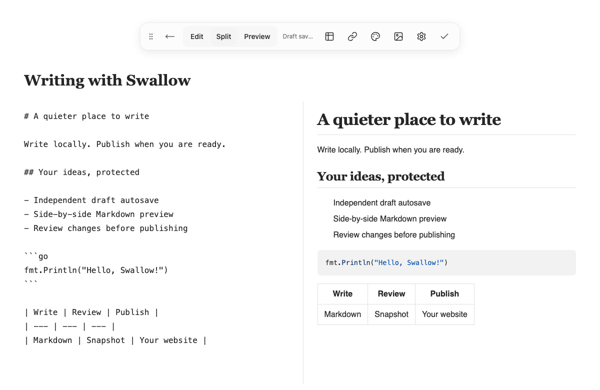
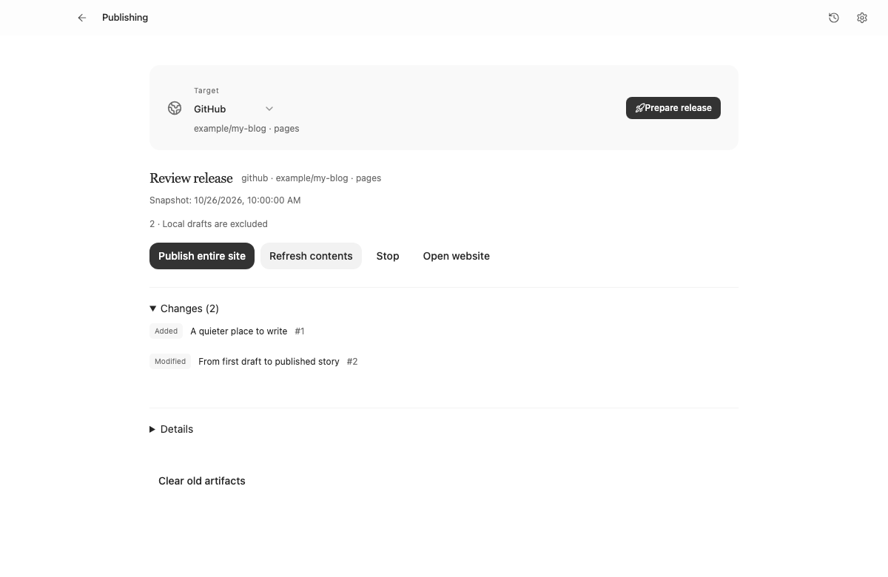

<h1 align='center'>Swallow</h1>

<p align="center">
   <br/>
</p>

<p align="center">
A cool static blog client.
</p>

<p align="center">
  <a href="https://github.com/rangwea/swallow/blob/main/LICENSE">
    
  </a>
  <a href="https://fjwoo.cn">
    
  </a>
  <a href="https://wails.io/">
    
  </a>
  <a href="https://react.dev/">
    
  </a>
</p>

<div align="center">
<strong>
<samp>

[English](README.md) · [简体中文](README_zh_cn.md)

</samp>
</strong>
</div>

## About

Swallow is a local-first desktop writing and publishing app for Hugo, built with Go, Wails and React. Write in Markdown, keep drafts separate from published articles, preview your site locally, and review an entire-site release before uploading it.

[Download releases](https://github.com/rangwea/swallow/releases) · [Build workflow](https://github.com/rangwea/swallow/actions/workflows/build.yml)

## Features

- **Markdown workspace:** edit, split and preview modes, syntax highlighting, tables, selection-to-link insertion, HTML text colors, and pasted or dropped images. Dock the floating editor toolbar on any edge.
- **Writing protection:** autosave to independent local drafts; save formal articles manually. Recover drafts after interruption and restore deleted articles from Trash. Local drafts are excluded from website publishing.
- **Article library:** compact article list, title and tag search, pagination, and publication status for the selected target.
- **Hugo preview:** preview the complete site locally and use bundled or compatible Hugo themes.
- **Publishing center:** prepare a frozen snapshot, review article and resource changes, then explicitly publish the entire site. Follow background progress and browse release history.
- **Failure recovery:** retry the original snapshot, verify uncertain remote results, and stop running tasks with an exit guard. Each target keeps its own successful publication baseline.
- **Deployment targets:** GitHub, Netlify, Tencent COS and Alibaba OSS. Object storage cleanup is limited to previously managed files.
- **Appearance:** multiple app themes, including pure white and neutral gray, with automatically saved preferences and English / Simplified Chinese interfaces.

The release workflow packages Windows and macOS builds. Linux can be built from source with the Wails platform prerequisites installed.

## Screenshots

The screenshots below use the v1.5.0 frontend with isolated demonstration data. The release screen shows a review state; no website was deployed to create these images.

### Markdown editor

Edit and preview side by side, with a compact toolbar and rich insertion tools.



### Publishing center

Review a frozen snapshot and its changes before publishing the entire site. History is available in an on-demand drawer.



## Development

### Requirements

- Go 1.27 or newer, matching `go.mod`.
- Node.js and npm (CI uses Node.js 20).
- Wails CLI v2.16.0 and the [platform prerequisites](https://wails.io/docs/gettingstarted/installation).
- A C compiler / CGO for extended Hugo and bundled theme support.

```sh
git clone --recurse-submodules https://github.com/rangwea/swallow.git
cd swallow
cd frontend
npm install
cd ..
wails dev -tags extended
```

Build a desktop application:

```sh
wails build -tags extended
```

The project configuration also enables the `extended` build tag. See [writing protection](docs/writing-protection.md) and [publishing center](docs/publishing-center.md) for storage and recovery details.

## Story

The project first author is a backend programmer mainly using Java and Python. He has worked on backend, middleware, and big data development. He likes to write small tools, so he taught himself some frontend knowledge.

The original intention of this project was to create a simple GUI wrapper for Hugo for a friend who is new to the field, allowing him to use Hugo to create his own blog.

There have been many explorations in the early stages of the project, resulting in multiple implementations of Swallow. Interested parties can follow the different implementations of Swallow for learning and discussion.

- [swallos-wails](https://github.com/rangwea/swallow-wails)： Base on [wails](https://wails.io/) framework using Go.
- [swallow-pywebview](https://github.com/rangwea/swallow-pywebview)： Base on [pywebview](https://pywebview.flowrl.com/) using Python，the frontend base on [alpinejs](https://alpinejs.dev/) and [tailwindcss](https://tailwindcss.com/)。
- [swallow-pyside](https://github.com/rangwea/swallow-pyside)： Base on [Pyside](https://doc.qt.io/qtforpython-6/).

Hugo integration requires Go 1.27+ and CGO for the bundled Jane theme. Build with `wails build -tags extended`; the project config also enables the `extended` build tag.
